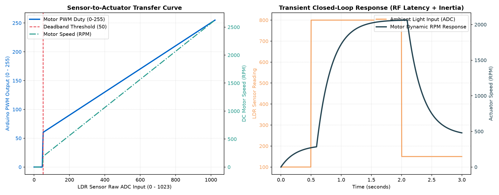

# 💡 Wireless Light-Intensity Controlled Motor using RF Communication

[](https://opensource.org/licenses/MIT)
[](https://www.arduino.cc/)
[]()
[]()

> Developed by **K Azaan Ahamed (23BEC0362)** and S S Sreenithie (23BEC0423) — Department of Communication Engineering, School of Electronics Engineering (SENSE), VIT Vellore.

A closed-loop wireless cyber-physical control system that measures ambient illumination using a Light Dependent Resistor (LDR), wirelessly transmits digital telemetry over a **433 MHz RF channel**, dynamically regulates a DC motor using proportional Pulse-Width Modulation (PWM) via an **L298N dual H-bridge**, and visualizes telemetry on both a **16×2 I2C LCD** and a **3-bit binary LED array**.

---

## 📌 System Architecture

```
+------------------------------------+         433 MHz RF Wireless Link        +-----------------------------------------+
|          TRANSMITTER NODE          | ~ ~ ~ ~ ~ ~ ~ ~ ~ ~ ~ ~ ~ ~ ~ ~ ~ ~ ~ > |              RECEIVER NODE              |
|                                    |               (ASK / OOK)               |                                         |
|  [LDR Optical Sensor]              |                                         |  [433 MHz RF RX Module]                 |
|           | (Analog A0)            |                                         |           | (Digital Pin 11)            |
|           v                        |                                         |           v                             |
|  [Arduino Uno Controller]          |                                         |  [Arduino Uno Controller]               |
|  - 10-bit ADC Oversampling         |                                         |  - Telemetry Decoding & Checksum Verify |
|  - Normalization & Digit Extract   |                                         |  - Proportional PWM Speed Mapping       |
|  - Manchester / Packet Framing     |                                         |  - Difference |A - B| Computation       |
|           |                        |                                         |      |             |             |      |
|           v                        |                                         |      v             v             v      |
|  [433 MHz RF TX Module (D12)]      |                                         | [L298N Driver]  [16x2 LCD]   [3-bit LEDs|
+------------------------------------+                                         |   | (PWM D9)     (I2C A4/A5)  (D2,D3,D4)|
                                                                               |   v                                     |
                                                                               | [DC Motor]                              |
                                                                               +-----------------------------------------+
```

---

## ⚙️ Mathematical Model & Digital Logic

1. **Light Sensing & Normalization**:
   $$ADC_{raw} \in [0, 1023], \quad \text{Norm} = \text{round}\left(\frac{ADC_{raw}}{1023} \times 99\right) \in [0, 99]$$
2. **Digit Extraction & Arithmetic Difference**:
   $$A = \lfloor\text{Norm} / 10\rfloor, \quad B = \text{Norm} \pmod{10}$$
   $$C = |A - B| \quad (\text{Constrained to } 0 \le C \le 7 \text{ for 3-bit representation})$$
3. **Binary LED Output Representation**:
   $$C = c_2 \cdot 2^2 + c_1 \cdot 2^1 + c_0 \cdot 2^0 \implies (\text{LED2, LED1, LED0})$$
4. **Proportional PWM Speed Law**:
   $$\text{PWM} = \begin{cases} 0 & \text{if } ADC_{raw} \le \text{Threshold} (50) \\ 60 + \frac{ADC_{raw} - 50}{1023 - 50} \times (255 - 60) & \text{if } ADC_{raw} > 50 \end{cases}$$

---

## 📊 Control Loop Dynamic Performance



- **Actuator Linearity**: Smooth proportional speed scaling above stall torque boundary.
- **Latency**: Total end-to-end response delay under 150 ms (including RF bit-banging transmission and motor electrical time constants).
- **Failsafe Watchdog**: Automatic motor de-energization if transmission drops for $>2.0\text{ seconds}$.

---

## 🔌 Hardware Wiring Specification

### Transmitter Node (Tx)
| Component | Arduino Pin | Function |
| :--- | :--- | :--- |
| LDR Sensor Output | `A0` | Analog light voltage divider |
| 433 MHz RF TX Data | `D12` | OOK / Manchester modulated RF signal |
| Power Bus | `5V` & `GND` | Common regulated DC power rail |

### Receiver Node (Rx)
| Component | Arduino Pin | Function |
| :--- | :--- | :--- |
| 433 MHz RF RX Data | `D11` | Demodulated digital input |
| L298N ENA (Speed) | `D9` | PWM speed modulation (Timer 1) |
| L298N IN1 / IN2 | `D8` / `D10` | Motor directional H-bridge gating |
| 16×2 LCD Display | `A4 (SDA)`, `A5 (SCL)` | I2C status & telemetry interface |
| Binary LEDs (c0, c1, c2) | `D2`, `D3`, `D4` | 3-bit binary difference representation |

---

## 🚀 Getting Started

1. Flash `firmware/transmitter/transmitter.ino` to the sensing Arduino Uno.
2. Flash `firmware/receiver/receiver.ino` to the motor actuator Arduino Uno.
3. Power both units; adjust ambient light or use a flashlight over the LDR to observe real-time proportional motor speed scaling and LCD telemetry.
4. To run the closed-loop control system simulation:
   ```bash
   python3 python/control_loop_model.py
   ```

---

## 📄 License
This repository is licensed under the [MIT License](LICENSE).
